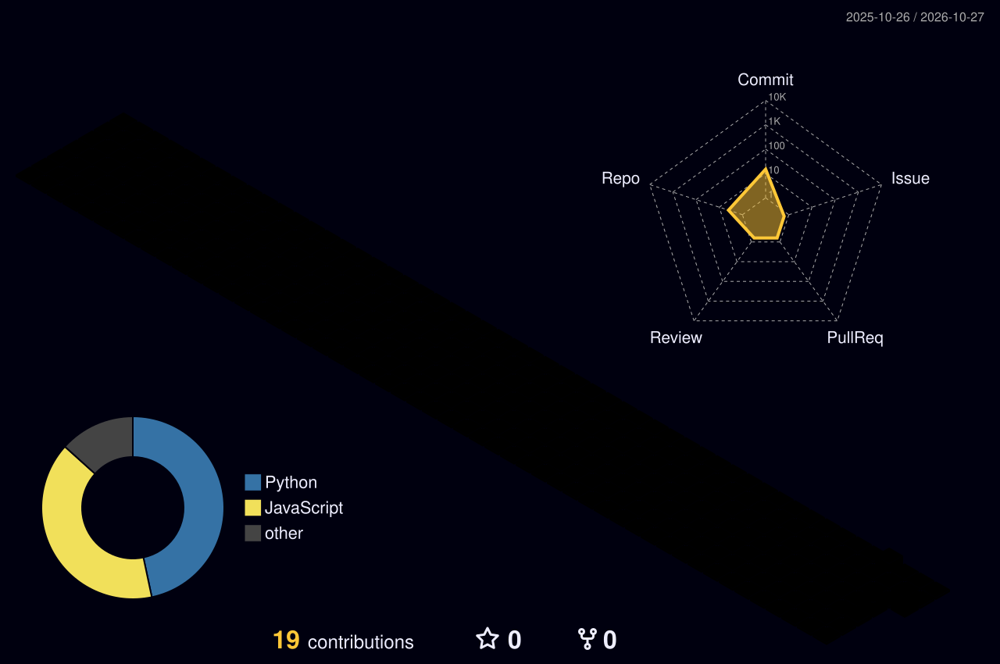

<!-- ===================== HEADER ===================== -->
<p align="center">
  
</p>

<p align="center">
  
</p>

<p align="center">
  <a href="https://git.io/typing-svg"></a>
</p>

<p align="center">
  
  
  
  <a href="https://vanns.my.id"></a>
</p>

---

### `> whoami`

```yaml
name:      Vann
role:      True Vibecoder 🎧  ·  Indie Builder  ·  Solo Ops
philosophy: "I describe it. The AI writes it. I ship it."
pair_programmer: an LLM (it never sleeps, neither do I)
currently:
  - running an LLM API reseller business for the Indonesian dev circle
  - building TileGrow, a Growtopia-style sandbox game in pure HTML5
  - letting AI agents babysit my VPS 24/7
```

---

### `> systemctl status vann-stack`

| Service | Status | What it does |
|:--|:--:|:--|
| 🔑 **LLM API Gateway** |  | Reseller API keys for LLMs, multi-backend routing, Telegram + Discord bots |
| 🎮 [**TileGrow**](https://github.com/VannStudent/TileGrow) |  | Growtopia-style sandbox game, vanilla JS + Node.js server |
| 📈 [**daily-log**](https://github.com/VannStudent/daily-log) |  | Automated daily VPS health log, committed by a bot |
| 🌐 [**vanns.my.id**](https://vanns.my.id) |  | Storefront & landing page, React |
| 🤖 **AI Ops Agent** |  | An AI agent that manages my server from Telegram |

---

### `> cat vibecoder.manifesto`

> 🧠 **Ideas > syntax.** I think in features, the AI thinks in code.
> ⚡ **Ship first, refactor with prompts.**
> 🔁 **Prompt → Run → Fix → Repeat** until it just works.
> 🛡️ **Vibes, but verified.** Logs, backups, rollbacks. Always.

```diff
+ lines of code I wrote by hand ......... very few
+ lines of code I shipped ............... a lot
+ prompts sent today .................... yes
- sleep ................................. deprecated
```

---

### `> ls ~/toolbox`

<p align="center">
  
</p>
<p align="center">
  
  
  
  
  
  
</p>

---

### `> htop --user vann`

<p align="center">
  
  
</p>
<p align="center">
  
</p>

---

### `> render --3d contributions`

<p align="center">
  
</p>

---

### `> tail -f contributions.log`

<p align="center">
  <picture>
    <source media="(prefers-color-scheme: dark)" srcset="https://raw.githubusercontent.com/VannStudent/VannStudent/output/snake-dark.svg" />
    
  </picture>
</p>

---

<p align="center">
  
</p>

<p align="center"><code>// built with vibes, prompts, and way too much coffee ☕</code></p>


